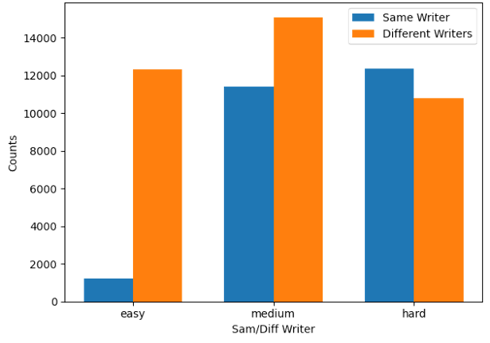

# Multi-Author Writing Style Analysis (PAN 2024)

**Where does the author change? Sentence-Transformers vs contrastive CoSENT encoders vs prompted LLMs**
CSE741 Natural Language Processing with Deep Learning, M.Sc. Computer & Systems Engineering, Alexandria University (Spring 2024)
Momen Ibrahim Fawzy · supervised by Dr. Nagwa El-Makky and Dr. Marwan Torki

Given a document written by several people, the task is to find every position where the author changes.
In the [PAN 2024 task](https://pan.webis.de/clef24/pan24-web/style-change-detection.html), each document is a
sequence of Reddit paragraphs, and the system labels every pair of consecutive paragraphs as *same author*
(0) or *change* (1). Three datasets control how much topic can help:

| Dataset | Topic signal | Documents (train / validation) |
|---|---|---|
| easy | paragraphs on different topics; topic shifts reveal author shifts | 4,200 / 900 |
| medium | little topical variety | 4,200 / 900 |
| hard | one topic throughout: style is the only signal | 4,200 / 900 |

Across all three datasets there are 63,191 consecutive pairs (51,993 train, 11,198 validation): 38,217 changes
and 24,974 same-author pairs. A paragraph averages 94 words, with the longest at 1,498.


*Consecutive pairs per difficulty. *Easy* is about 90% changes, so topic shifts nearly always mean a new
author. *Hard* has slightly more same-author pairs than changes.*

## Methods

**Pair construction** (`style_change/pairs.py`). Ground truth labels only *neighbouring* paragraphs, so
there is no author id per paragraph. Two ways to build training pairs:

| Approach | Positives (same author) | Negatives (different authors) |
|---|---|---|
| 1 · consecutive | neighbours with label 0 | neighbours with label 1 |
| 2 · grouped | every pair within a run of same-author paragraphs | every pair across two *adjacent* runs |

Approach 2 gives more pairs and also pairs that are not adjacent. Non-adjacent runs are never paired as
negatives, because an author can reappear later in the document.

**1. Sentence-Transformers** (`style_change/sbert.py`). `all-MiniLM-L12-v2` and `all-mpnet-base-v2`
bi-encoders, fine-tuned with a contrastive loss so that same-author paragraphs end up close in embedding
space. Each epoch samples a fresh 70% of the pairs. At inference, a change is predicted when the cosine
similarity of two neighbouring paragraphs drops below 0.5. Paragraphs longer than the encoder window are
split into 256-token chunks, aligned cyclically, and scored by the mean chunk similarity.

**2. CL-MAWSA** (`style_change/cosent.py`), the contrastive approach of Chen et al. (PAN 2023). A DeBERTa
encoder is trained with the CoSENT loss

$$\mathcal{L} = \log\Big(1 + \sum_{(i,j)\in\text{pos},\,(k,l)\in\text{neg}} e^{\lambda(\cos(u_k,u_l) - \cos(u_i,u_j))}\Big)$$

so that every same-author pair in a batch ranks above every different-author pair. The encoder is then
frozen, paragraphs are embedded by their `[CLS]` vector, and a tanh classifier on $[u; v; |u-v|]$ is trained
with cross-entropy.

**3. Prompted LLMs** (`style_change/llm.py`). `gpt-3.5-turbo`, `llama-3-70b-instruct` and
`mixtral-8x7b-instruct` receive the whole document and must return `{"changes": [...]}` with exactly
`n − 1` binary labels. The prompt was developed on 50 training documents per difficulty and then run on
the full validation sets at temperature 0. LLM answers are often malformed (prose around the JSON, two JSON
objects, labels as strings, wrong length). The parser recovers what it can, unanswered documents are
counted, and every answer is cached with its raw text.

**Evaluation** (`style_change/metrics.py`): macro F1 over all paragraph pairs of a dataset, the official
PAN 2024 measure.

## Results (validation macro F1)

| Model | Easy | Medium | Hard |
|---|:---:|:---:|:---:|
| **all-mpnet-base-v2**, approach 1 | **0.989** | **0.880** | **0.839** |
| all-mpnet-base-v2, approach 2 | 0.986 | 0.880 | 0.835 |
| all-MiniLM-L12-v2, approach 1 | 0.974 | 0.869 | 0.827 |
| all-MiniLM-L12-v2, approach 2 | 0.981 | 0.871 | 0.801 |
| CL-MAWSA (CoSENT + classifier) | 0.897 | 0.807 | 0.695 |
| gpt-3.5-turbo (prompted) | 0.940 | 0.871 | 0.820 |
| llama-3-70b-instruct (prompted) | 0.922 | 0.836 | 0.768 |
| mixtral-8x7b-instruct (prompted) | 0.892 | 0.798 | 0.737 |

What the numbers say:
- **Topic does much of the work on *easy*.** Every method loses 10–15 points from easy to hard, where only
  style is left.
- **A fine-tuned 110M-parameter bi-encoder beats every prompted LLM**, by 1–5 points on hard. It is also
  far cheaper per document and deterministic. Sentence-Transformers start from encoders already trained on
  paired data, which suits a pairwise task better than CL-MAWSA's plain DeBERTa start (0.695 on hard).
- **Approach 2's extra pairs help in training but not on validation.** Train F1 goes up slightly, but
  validation scores are equal or lower, particularly MiniLM on hard. The extra non-adjacent pairs teach
  similarities that differ from what is evaluated.
- **Among LLMs, GPT-3.5 > Llama-3-70B > Mixtral-8x7B** at every difficulty. The open models fail the output
  format more often, which costs them directly.

Train/validation tables and further notes are in [`docs/results.md`](docs/results.md).

**Origin.** The project began as the proposal *Taking LLMs for Granted?*, which questioned whether prompted
LLMs really solve NLP tasks they look good on, using Arabic sentiment analysis and multi-author style
analysis as test cases. The final project kept the style-analysis half and turned it into a direct
comparison: prompted LLMs against small models fine-tuned for the task.

## Repository layout

```
src/style_change/
  pan.py       PAN 2024 reader/writer (problem-*.txt, truth-problem-*.json, solution-problem-*.json)
  pairs.py     approach 1 (consecutive) and approach 2 (grouped) pair construction
  stats.py     documents, pairs, label balance and paragraph lengths per dataset
  sbert.py     Sentence-Transformer training, chunked pair scoring, threshold tuning
  cosent.py    CL-MAWSA: CoSENT loss, encoder training, frozen-feature classifier
  llm.py       prompt, robust answer parsing, cached OpenAI-compatible client
  metrics.py   macro F1 over pairs, coverage of unanswered documents
scripts/  dataset_stats.py · prepare_pairs.py · train_sbert.py · predict_sbert.py · train_cl_mawsa.py · run_llm.py · evaluate.py
configs/  sbert.yaml · cl_mawsa.yaml
tests/    unit tests for the data format, pair construction, metrics, LLM parsing, chunking and the CoSENT loss
```

## Usage

```bash
pip install -e ".[sbert,cosent,llm,dev]"
# PAN 2024 data: https://pan.webis.de/clef24/pan24-web/style-change-detection.html (not redistributed)
DATA=data/pan24-multi-author-analysis

python scripts/dataset_stats.py --data $DATA

# Sentence-Transformers (one model per difficulty)
python scripts/train_sbert.py --data $DATA --difficulty hard --approach consecutive \
  --model sentence-transformers/all-mpnet-base-v2
python scripts/predict_sbert.py --model runs/sbert/all-mpnet-base-v2_consecutive_hard/best \
  --problems $DATA/hard/validation --out results/sbert/hard

# CL-MAWSA
python scripts/train_cl_mawsa.py --data $DATA --difficulty hard

# LLMs (keys are read from the environment, never from code)
export OPENAI_API_KEY=...
python scripts/run_llm.py --data $DATA --model gpt-3.5-turbo --split validation
export PERPLEXITY_API_KEY=...
python scripts/run_llm.py --data $DATA --provider perplexity --model llama-3-70b-instruct

python scripts/evaluate.py --truth $DATA --solutions results/sbert
python -m pytest tests
```

## References
- J. Bevendorff et al. *Overview of PAN 2024: Multi-Author Writing Style Analysis, ...* ECIR 2024.
- H. Chen, Z. Han, Z. Li, Y. Han. *A Writing Style Embedding Based on Contrastive Learning for Multi-Author Writing Style Analysis.* CLEF Working Notes 2023.
- N. Reimers, I. Gurevych. *Sentence-BERT: Sentence Embeddings using Siamese BERT-Networks.* EMNLP 2019.
- J. Su. *CoSENT: A more efficient sentence vector scheme than Sentence-BERT.* 2022.

Code in this repository: MIT licence.
